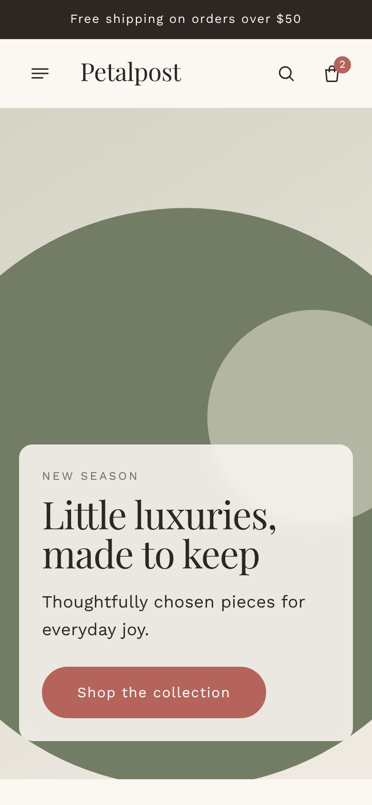
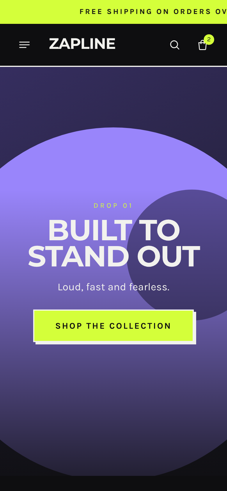
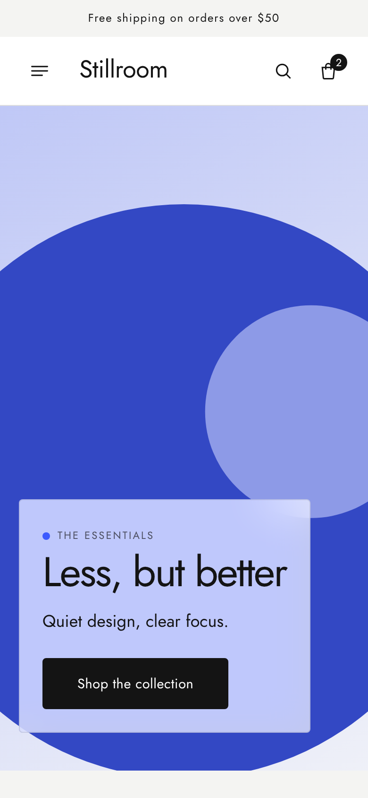
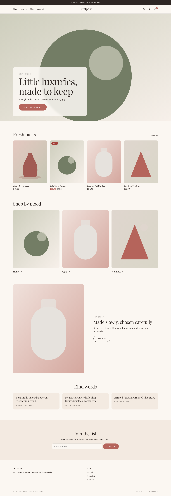
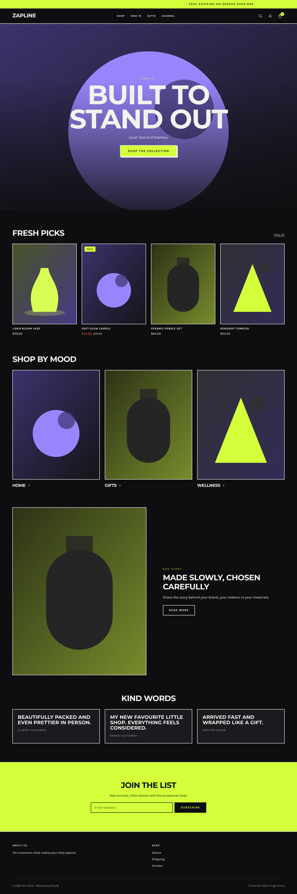
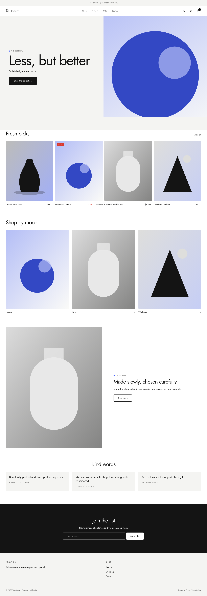

# Free Shopify themes by Pretty Things Online

Three free, modern **Shopify Online Store 2.0** themes, made with care by **[Pretty Things Online](https://prettythingsonline.com)**. Free for personal and commercial use under the MIT license.

**[⬇ Download the latest release](../../releases/latest)**

| | Theme | Style | Great for |
|---|---|---|---|
|  | **Petalpost** | Soft boutique: rose, cream and an editorial serif | gifts, candles, ceramics, beauty, jewelry, handmade |
|  | **Zapline** | Bold streetwear: black, electric lime, oversized type | streetwear, sneakers, merch, gaming, music |
|  | **Stillroom** | Clean minimal: white space, split hero, glassy header | skincare, electronics, furniture, coffee, basics |

## Previews

### Petalpost

### Zapline

### Stillroom

*Previews use placeholder artwork. Your product photos go in their place.*

## Features (all three themes)

- Online Store 2.0: JSON templates, sections everywhere, header and footer section groups
- Hero banner (3 layouts), featured collection, collection list, image with text, rich text, testimonials, newsletter, Custom Liquid and Apps sections
- Product page with gallery, pill-style variant picker, dynamic checkout buttons, Shop Pay installments, pickup availability, collapsible tabs and related products
- Collection filtering and sorting, predictive search
- Cart with order notes, discounts, unit prices and accelerated checkout
- Customer accounts, blog, contact page, password page and gift card templates
- 3 colour presets per theme, font pickers, corner radius and page width controls
- Lightweight: one CSS file and one small vanilla JS file, no jQuery, no app dependencies
- Accessible: skip link, visible focus, keyboard friendly menus, reduced motion support
- Passes Shopify Theme Check with 0 errors and 0 warnings

## Install

1. Download a theme zip from the [latest release](../../releases/latest) (don't unzip it).
2. In Shopify admin go to **Online Store > Themes > Add theme > Upload zip file**.
3. Click **Customize**, add your logo, images and collections, then **Publish**.

You can also connect this repo to your store with Shopify's GitHub integration and point it at a theme folder, or use `shopify theme push --path themes/<name>`.

## Tips

- The header uses the `main-menu` navigation and the footer uses `footer` (**Content > Menus**).
- Install Shopify's free *Search & Discovery* app to choose collection filters.
- For a contact page, create a page and pick the `page.contact` template.
- The small "Theme by Pretty Things Online" footer credit can be switched off under **Theme settings > Theme credit**. Keeping it is a lovely way to say thanks.

## Repo layout

- `themes/<name>/`: ready-to-upload theme source
- `listings/`: marketplace listing copy
- `tools/`: the shared base theme and the scripts that build the three looks, run Theme Check and render previews

## Support

Questions or ideas: [prettythingsonline.com](https://prettythingsonline.com)

## License

MIT © Pretty Things Online
